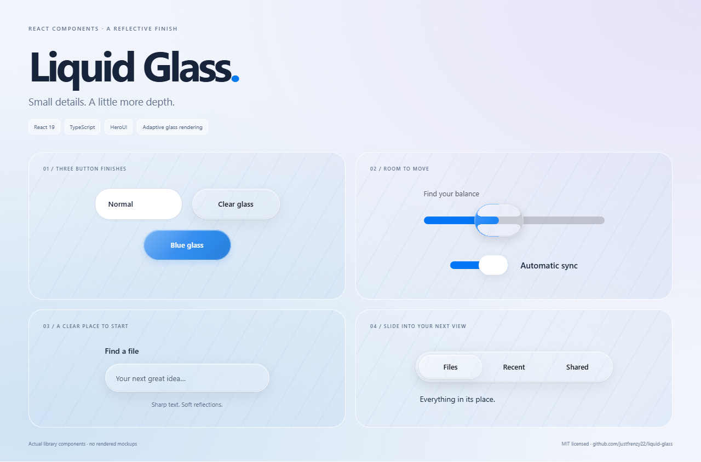
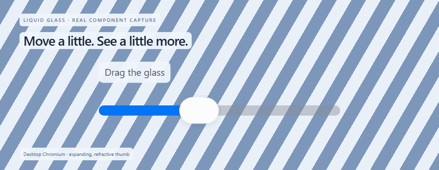
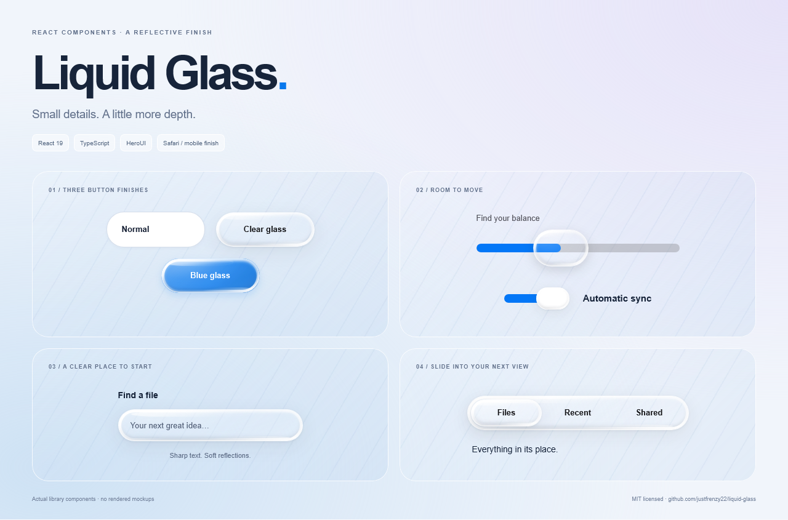
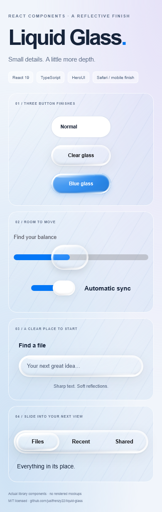

# Liquid Glass

[](https://github.com/justfrenzy22/liquid-glass/actions/workflows/ci.yml)
[](https://github.com/justfrenzy22/liquid-glass/releases)
[](LICENSE)

A React and TypeScript component library for reflective glass interfaces, combining a custom optical layer with native controls and styled HeroUI components.



**[Install](#install) | [Component guides](https://github.com/justfrenzy22/liquid-glass/blob/main/docs/components/README.md) | [Component list](#included-components) | [See it move](#see-it-move)**

Curious about the optics, Safari treatment and design tradeoffs? Read the [research notes](https://github.com/justfrenzy22/liquid-glass/blob/main/docs/RESEARCH.md) for sources, implementation decisions, reproducible checks and open questions.

- Desktop Chromium can refract the backdrop through SVG displacement maps.
- Safari, iPhone, iPad, Firefox and other mobile browsers use native blur, curved reflections and beveled highlights.
- Normal buttons, solid cards and alternating-row tables provide calmer alternatives.
- Controls retain keyboard operation, disabled states and reduced-motion support. Text remains on a separate, sharp layer.
- Compiled JavaScript, TypeScript declarations and CSS are included. Styles load automatically. Tailwind CSS 4 powers layout authoring; no library source scanning, Next.js or remote assets are required.

**Release:** `0.3.3`. Repository: `liquid-glass`. Package/import name: `@justfrenzy/liquid-glass`.

## Tailwind customization

Use `className` for utility overrides and `classNames` to target Button, Navbar and Sidebar parts. The exported `cn()` helper merges classes when creating your own components. Read the [Tailwind setup and customization guide](https://github.com/justfrenzy22/liquid-glass/blob/main/docs/tailwind.md) for commands, theme utilities and complete examples.

## Install

Need working examples? Start with the [setup guide](https://github.com/justfrenzy22/liquid-glass/blob/main/docs/getting-started.md), [Button](https://github.com/justfrenzy22/liquid-glass/blob/main/docs/components/LiquidButton.md), [Navbar](https://github.com/justfrenzy22/liquid-glass/blob/main/docs/components/LiquidNavbar.md), or [all component guides](https://github.com/justfrenzy22/liquid-glass/blob/main/docs/components/README.md).

Requires React 19, React DOM 19 and Tailwind CSS 4 (declared peers), with an ESM-aware bundler such as Vite or Next.js.

```sh
npm install @justfrenzy/liquid-glass
```

For an application that does not already have React:

```sh
npm install react@19 react-dom@19
# TypeScript applications also need the React types:
npm install -D @types/react @types/react-dom
```

Styles load automatically when your frontend imports a component from the core or `/heroui` entry. No separate stylesheet import or library development server is needed.

The explicit `@justfrenzy/liquid-glass/styles.css` export remains available if your build requires manual stylesheet placement. Plain Node.js server rendering uses a CSS-free entry; browser bundlers use the entry that loads styles.

The CSS contains precompiled Tailwind-backed CSS modules and a small reset scoped to library surfaces. Component defaults work without compiling library source. Configure Tailwind in your own app to use custom utility classes; no HeroUI global theme is needed. HeroUI is a package dependency. React and the verified React Aria versions are shared peers, installed automatically by modern npm; this prevents multiple incompatible copies. If your app already uses newer React Aria versions, reconcile those exact peer requirements before upgrading.

## One component collection

```tsx
"use client";

import { useState } from "react";
import { LiquidButton, LiquidSlider, GlassRenderingProvider } from "@justfrenzy/liquid-glass";

export function Controls() {
  const [volume, setVolume] = useState(40);
  return (
    <GlassRenderingProvider mode="auto">
      <LiquidButton onPress={() => console.log("Clicked")}>Continue</LiquidButton>
      <LiquidSlider label="Volume" value={volume} onChange={(value) => setVolume(Number(value))} />
    </GlassRenderingProvider>
  );
}
```

The provider is optional; the default mode is `auto`. Place glass over a picture, gradient, pattern or other visible content to see the optical effect.

## Empty states

Use `GlassEmptyState` for empty folders, no search results or first-use screens. Supply your own action and application behavior:

```tsx
"use client";

import { GlassEmptyState, GlassButton } from "@justfrenzy/liquid-glass";

export function EmptyFolder({ onUpload }: { onUpload: () => void }) {
  return (
    <GlassEmptyState
      title="No files yet"
      description="Upload your first file to get started."
      actions={<GlassButton onPress={onUpload}>Upload a file</GlassButton>}
    />
  );
}
```

The optional `icon` slot is decorative. The heading labels the region and the description is associated automatically. Pass `mode="compatible"` to force the Safari-style finish. It is also exported as `LiquidEmptyState` from `/heroui`; both names refer to the same component.

## Buttons, switches and inputs

```tsx
"use client";

import { useState } from "react";
import { LiquidButton, LiquidSwitch, LiquidInput } from "@justfrenzy/liquid-glass";

export function FormControls() {
  const [sync, setSync] = useState(true);
  const [name, setName] = useState("");
  return (
    <>
      <LiquidButton appearance="normal">Normal</LiquidButton>
      <LiquidButton appearance="glass">Clear glass</LiquidButton>
      <LiquidButton appearance="colored" glassColor="#0878ed">Blue glass</LiquidButton>
      <LiquidSwitch label="Automatic sync" isSelected={sync} onChange={setSync} />
      <LiquidInput label="Project name" value={name} onChange={setName} />
    </>
  );
}
```

Use `onPress`, `isDisabled` and the value props shown in each component guide. Matching names such as `GlassButton`/`LiquidButton`, `GlassSwitch`/`LiquidSwitch`, `GlassNavbar`/`LiquidNavbar` and `GlassSidebar`/`LiquidSidebar` are aliases of the same component, with the same props and liquid design. All main components are available from the package root. Existing `/heroui` imports remain supported.

**Upgrading from 0.1.x?** Some root `Glass*` props have changed. Read the [0.2 migration guide](https://github.com/justfrenzy22/liquid-glass/blob/main/docs/migration-0.2.md). The previous native APIs remain available explicitly from `/native`.

### Next.js

Component imports load the styles in the client bundle. Put callbacks and interactive state in a component marked `"use client"`. Generated entry points and shared chunks retain that directive; SSR starts with readable basic glass before client detection enhances it. The compiled archive does not require `transpilePackages`.

Navbar and Sidebar use ordinary links, so no Next.js router is required. Use `onNavigate` or your application's router integration for SPA navigation.

Navbar `brand` accepts text, JSX, SVG or an image. Use `brandIcon` for an automatically aligned decorative icon beside the brand, and `brandHref` to make the whole brand a link. Styled text such as `brand={<span><strong>Code</strong>Drive</span>}` also works. See the [Navbar brand examples](https://github.com/justfrenzy22/liquid-glass/blob/main/docs/components/LiquidNavbar.md#icon-svg-and-styled-brand-text).

## See it move



Recorded from the library components in Chromium. Pressing expands the thumb; dragging refracts the stripes behind it. These are real component captures, not concept renders.

<details>
<summary><strong>Safari-compatible finish and mobile layout</strong></summary>

The compatible renderer uses simulated reflections and native blur. These captures use Playwright WebKit, including an iPhone-emulated viewport; they are not photographs of physical Apple devices.

**Compatible glass - WebKit desktop**



**Mobile layout - iPhone emulation**



</details>

## Light and dark themes

Control text inherits your application's `color` instead of forcing black. Neutral glass tints and solid fills follow the operating-system preference; `.dark`, `.light`, `data-theme="dark|light"` and `data-liquid-theme="dark|light"` on an ancestor override that preference. Put the theme marker on `html` or `body` so portal overlays receive it too. The library does not change the application's body text color or background.

Colored buttons keep white labels by default. You can override the foreground tokens for your palette:

```css
.my-theme {
  --lg-foreground: #edf2f7;
  --lg-muted: #b9c5d8;
  --lg-solid-background: #1c2432;
  --lg-glass-rgb: 24 32 46;
  --lg-on-accent: white;
}
```

`--lg-foreground` is optional: leave it unset to inherit text color. Check contrast for your chosen background and accent colors; arbitrary color combinations are not automatically contrast-corrected.

## Rendering modes

| Mode | Behavior |
| --- | --- |
| `auto` | Supported desktop Chromium gets SVG refraction; Safari and phones/tablets get compatible reflective glass. |
| `compatible` | Forces native blur, simulated curved reflections, corner glints and a deeper beveled rim. |
| `fallback` | Basic blur and tint without the stronger reflection layers. |

Use `<GlassRenderingProvider mode="compatible">...</GlassRenderingProvider>` to set a default, including for portal overlays. Individual controls accept `glass={{ mode: "compatible" }}`; GlassSurface takes `mode` directly. An explicit per-control mode overrides the provider.

Detection checks CSS capabilities, navigator information, optional mobile client hints and likely iPadOS desktop UAs. It is a best-effort rendering hint, not guaranteed hardware identification. Responsive layout uses CSS. Safari reflections are simulated and do not bend arbitrary live background content like the Chromium shader. Nested translucent containers can reduce visible effects; real-device review is still useful.

## Component guides

**[Browse all 91 component guides](https://github.com/justfrenzy22/liquid-glass/blob/main/docs/components/README.md)** to find a component's import, copyable example, required props and usage notes.

| Start here | Guide |
| --- | --- |
| Installation, Next.js and themes | [Getting started](https://github.com/justfrenzy22/liquid-glass/blob/main/docs/getting-started.md) |
| Buttons and appearance options | [Button](https://github.com/justfrenzy22/liquid-glass/blob/main/docs/components/LiquidButton.md) |
| Navigation links and active routes | [Navbar](https://github.com/justfrenzy22/liquid-glass/blob/main/docs/components/LiquidNavbar.md) |
| Collapsible navigation | [Sidebar](https://github.com/justfrenzy22/liquid-glass/blob/main/docs/components/LiquidSidebar.md) |
| Sidebar button, modal and form | [New Folder recipe](https://github.com/justfrenzy22/liquid-glass/blob/main/docs/recipes/sidebar-new-folder.md) |
| Skeletons, top actions and custom sidebar sections | [Compose your sidebar](https://github.com/justfrenzy22/liquid-glass/blob/main/docs/recipes/sidebar-composition.md) |
| Text fields and controlled values | [Input](https://github.com/justfrenzy22/liquid-glass/blob/main/docs/components/LiquidInput.md) |
| Data, row selection and appearance | [Table](https://github.com/justfrenzy22/liquid-glass/blob/main/docs/components/LiquidTable.md) |

## Included components

**Shared surfaces and aliases:** GlassEmptyState, GlassSurface, GlassRenderingProvider, GlassButton, GlassIconButton, GlassInput, GlassSearch, GlassSwitch, GlassSlider, GlassCard, GlassPanel, GlassToolbar, GlassNavbar, GlassSidebar, GlassFileCard, GlassFolderCard, GlassUploadButton and GlassSearchBar. Also exported: useGlassEnvironment, glassDefaults, GlassConfig and environment-selection helpers. Matching Glass/Liquid controls share the enhanced implementation; the original native controls are available from `/native`.

The following names use the `Liquid` prefix and are available at the package root (and `/heroui` for compatibility):

| Group | Components |
| --- | --- |
| Essentials | Button, Slider, Switch, Input, Checkbox, Tabs, Select, Card, Modal |
| Feedback | Dropdown, Tooltip, Popover, Accordion, Alert, ToastProvider, ProgressBar, ProgressCircle |
| Identity/navigation | Avatar, AvatarGroup, Badge, Chip, ToggleButton, Navbar, Sidebar, Breadcrumbs, Pagination |
| Forms | SearchField, TextArea, NumberField, RadioGroup, CheckboxGroup, Autocomplete, DateRangePicker, Fieldset, InputGroup, InputOTP, ErrorMessage |
| Dates/data | Calendar, RangeCalendar, DateField, TimeField, DatePicker, ComboBox, ListBox, Table |
| Dialog/disclosure | AlertDialog, Drawer, Disclosure, DisclosureGroup |
| Colors | ColorArea, ColorField, ColorPicker, ColorSlider, ColorSwatch, ColorSwatchPicker |
| Helpers | ButtonGroup, CloseButton, Toolbar, Meter, Skeleton, Spinner, Surface, ScrollShadow, Separator, Kbd, Link, Typography, TagGroup |

Also exported: **SolidCard**, **FinderTable**, **LiquidForm**, **LiquidActionButton**, `toast` and `parseColor`. Label, Description, FieldError and TextField are composed inside controls rather than exposed as standalone styled wrappers. A ToggleButtonGroup is intentionally omitted; draggable tabs cover that interaction.

TypeScript declarations describe each wrapper's exact props; not every possible HeroUI composition is exposed. Table/FinderTable uses `columns: { id, label, isRowHeader? }[]`, `rows: { id, values: Record<string, ReactNode> }[]` and `aria-label`. Navbar/Sidebar uses `items: { id, label, href, icon?, count? }[]`, `activeKey` and `onNavigate`. See the usage examples above for direct imports.

## How it was built

The library was developed iteratively with Codex assistance:

1. Separate the transparent decoration from readable content. GlassSurface owns the backdrop; real controls sit above it.
2. Implement rounded-rectangle geometry, an analytic superellipse bevel and a Snell-law approximation. Browser canvas generates small displacement/specular maps, and SVG composes the Chromium effect.
3. Add native inputs and real HeroUI controls. Custom pointer capture keeps switch/tab lenses under the pointer and commits selection on release while preserving keyboard operation.
4. Introduce normal, clear and colored finishes, plus calm cards and Finder-style tables for dense content.
5. Build the Safari/mobile CSS rendering path with reflective bands, edge lighting, automatic selection and explicit overrides.
6. Extract the implementation into this repository: remove app aliases and Next.js imports, replace utility classes with CSS modules, preserve client boundaries, and verify the built package in an independent React consumer.

Kube's [Liquid Glass article](https://kube.io/blog/liquid-glass-css-svg/) informed the optical/interaction approach. This implementation was independently authored; no Kube code or assets are distributed. HeroUI supplies substantial control behavior. This is not an official Kube or HeroUI package. See [architecture](https://github.com/justfrenzy22/liquid-glass/blob/main/docs/architecture.md) and [third-party notices](THIRD_PARTY_NOTICES.md).

## Package contents

Install the package into your existing React application and use the imports above. No library development server, demo application, source build or Python setup is required.

The release archive contains compiled ESM, TypeScript declarations, CSS, this README, component usage guides, the changelog and license notices. It excludes test fixtures, demo pages, development scripts, development dependency metadata and research media. React 19 is supplied by your application; npm installs the library's runtime dependencies and required peers.

This is an early `0.2.x` library. Browser differences and the rendering limitations described above still apply; publishing a consumer package is not a claim that all components have completed usability or accessibility audits.

For source contributions and release checks, see [CONTRIBUTING.md](https://github.com/justfrenzy22/liquid-glass/blob/main/CONTRIBUTING.md). For changes in this release, see [CHANGELOG.md](CHANGELOG.md).

## License

MIT for this repository's code. Dependencies retain their own licenses. See [LICENSE](LICENSE) and [THIRD_PARTY_NOTICES.md](THIRD_PARTY_NOTICES.md).
